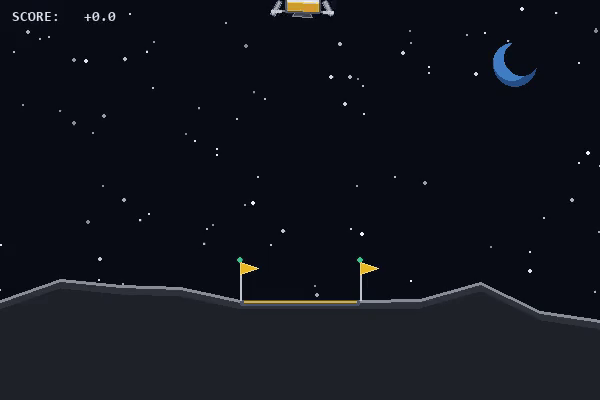
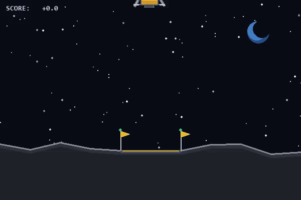
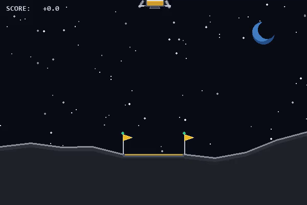

# Autonomous Lunar Lander: PPO Reinforcement Learning and Reward Shaping

An experimental study in deep reinforcement learning using **Gymnasium (`LunarLander-v3`)** and **Stable-Baselines3 (Proximal Policy Optimization)**. This project trains an autonomous control policy from an 8-dimensional continuous state space, demonstrates **specification gaming (reward hacking)** under naive state-based reward modifications, and resolves policy misalignment using **potential-based reward shaping**. It also includes a custom Pygame rendering wrapper (`lunar_ui.py`) that upgrades the default Box2D viewport while preserving physical geometry.

---

## Visual Demonstrations

| 1. Baseline PPO Policy | 2. Reward Hacking (Hover Exploit) | 3. Potential-Based Shaped Policy |
| :---: | :---: | :---: |
|  |  |  |
| Trained on the unmodified environment reward. Achieves stable descent and touchdown between the target flags. | Trained with a naive `+1.5` per-step bonus for remaining upright and slow in mid-air. The agent exploits the rule by hovering until the 1,000-step timeout. | Trained with potential-based difference shaping and a `-0.05` per-step time penalty. Eliminates loitering and produces a direct, centered landing. |

---

## Problem Formulation (Markov Decision Process)

The `LunarLander-v3` environment simulates a 2D rocket descending toward a landing pad on the lunar surface at **50 Hz** (50 physics ticks per second).

### 1. Observation Space (`Box(8,)`)
At each frame `t`, the agent receives an 8-dimensional state vector `s_t` without visual pixel access:

| Index | Observation Variable | Type | Physical Meaning |
| :---: | :--- | :--- | :--- |
| `0` | `x` | Continuous | Horizontal offset from landing pad center (`0.0` = centered) |
| `1` | `y` | Continuous | Vertical altitude above the landing pad (`0.0` = pad level) |
| `2` | `v_x` | Continuous | Horizontal velocity (positive = drifting right) |
| `3` | `v_y` | Continuous | Vertical velocity (negative = descending) |
| `4` | `theta` | Continuous | Roll/pitch angle in radians (`0.0` = upright) |
| `5` | `omega` | Continuous | Angular velocity in radians/second |
| `6` | `leg_left` | Binary (`0` or `1`) | Left landing strut ground-contact indicator |
| `7` | `leg_right` | Binary (`0` or `1`) | Right landing strut ground-contact indicator |

### 2. Action Space (`Discrete(4)`)
At each frame, the policy network selects one of four discrete thruster commands:
* `0`: **Idle** (no thrusters fired)
* `1`: **Fire Left Orientation Engine** (pushes nozzle left, induces clockwise torque)
* `2`: **Fire Main Engine** (upward thrust along the longitudinal axis of the hull)
* `3`: **Fire Right Orientation Engine** (pushes nozzle right, induces counter-clockwise torque)

### 3. Default Environment Reward Function
The built-in `LunarLander-v3` reward evaluates a frame-by-frame shaping potential `P(s_t)` based on distance to the pad, linear speed, tilt angle, and leg contact:

```text
P(s_t) = -100 * sqrt(x^2 + y^2) - 100 * sqrt(v_x^2 + v_y^2) - 100 * |theta| + 10 * leg_left + 10 * leg_right
```

* **Step Reward:** `r_t = P(s_t) - P(s_{t-1}) - fuel_cost`
* **Fuel Cost:** `0.30` per frame when firing the main engine; `0.03` per frame when firing a side orientation engine.
* **Terminal Reward:** `+100` for coming to rest safely on the pad; `-100` if the main lander body collides with the surface or flies out of bounds.
* **Solution Threshold:** An average episode return of **`>= 200.0`** over consecutive evaluation episodes is defined as solved.

---

## Reward Engineering and Specification Gaming

A core objective of this repository is demonstrating how reinforcement learning agents optimize the exact mathematical reward function provided, often at the expense of the designer's intended behavior.

### Experiment 1: Baseline Policy (`02_train_baseline.py`)
Trains Proximal Policy Optimization (PPO) directly on the unmodified `LunarLander-v3` reward for `1,000,000` timesteps across 4 parallel vectorized environments.

### Experiment 2: Inducing Reward Hacking (`04_reward_hack.py`)
To encourage stable, controlled flight, a naive reward rule might pay a bonus whenever the rocket maintains an upright posture and low velocity in mid-air:

```text
if |theta| < 0.20 and |v_x| < 0.25 and |v_y| < 0.25 and (leg_left + leg_right == 0):
    r_t = r_t + 1.5
```

**Failure Mode Analysis:**
* Episodes truncate after `1,000` frames.
* By hovering above the ground without touching down, the agent can collect up to `1,000 * 1.5 = +1,500` bonus points while expending at most `~300` points in main engine fuel.
* Touching down on the pad immediately terminates the episode and halts the per-frame bonus stream.
* Consequently, the PPO policy learns to **hover indefinitely in mid-air** rather than land, achieving an inflated training score (`800+`) while failing the actual landing task when evaluated on the true environment.

### Experiment 3: Mitigation via Potential-Based Shaping (`05_reward_fixed.py`)
To eliminate the hover exploit while still guiding the rocket toward a centered, upright approach corridor, `FixedShapingWrapper` implements two principles:

1. **Potential-Based Difference Shaping:** Instead of paying for *being* in a desirable state, the wrapper defines a state potential function `Phi(s)` and rewards only the *net improvement* between consecutive frames (`Phi(s_t) - Phi(s_{t-1})`). A stationary hovering rocket produces zero state change (`Phi(s_t) - Phi(s_{t-1}) = 0`), removing the incentive to stall:

```text
Phi(s) = -20.0 * |x| - 20.0 * |theta| - 10.0 * (|v_x| + |v_y|)
shaping_bonus = Phi(s_t) - Phi(s_{t-1})
```

2. **Step Time Penalty:** A constant penalty of `-0.05` is applied on every non-terminal frame so that loitering in the sky carries an explicit cost, incentivizing a prompt touchdown.

---

## Model Architecture and Hyperparameters

All experiments use the same PPO policy architecture and optimization settings to isolate the effect of the reward function:

| Parameter | Value | Description |
| :--- | :--- | :--- |
| **Algorithm** | PPO (Clipped Surrogate Objective) | Stable-Baselines3 implementation |
| **Policy Network** | `MlpPolicy` (`64 -> 64`, `tanh`) | Two-layer actor and critic multilayer perceptrons |
| **Parallel Environments** | `4` (`make_vec_env`) | Vectorized synchronous data collection |
| **Rollout Buffer (`n_steps`)** | `1024` per environment | `4096` transitions per rollout update |
| **Minibatch Size** | `64` | Stochastic gradient descent batch size |
| **Optimization Epochs** | `4` | Passes over rollout buffer per update |
| **Discount Factor (`gamma`)** | `0.999` | Long-horizon credit assignment |
| **Learning Rate** | `3e-4` | Adam optimizer step size |

---

## Experimental Results

To prevent custom wrapper bonuses from distorting comparisons, all trained models are evaluated in `03_eval_and_record.py` over **10 deterministic episodes with all custom reward wrappers disabled**:

| Experiment | Script | Training Timesteps | Wrapped Training Return | True Unwrapped Eval Return | Outcome |
| :--- | :--- | :---: | :---: | :---: | :--- |
| **1. Baseline PPO** | `02_train_baseline.py` | `1,000,000` | `~240` | **`> 220` (Solved)** | Reliable descent and touchdown between flags |
| **2. Reward Hacked** | `04_reward_hack.py` | `800,000` | `~900+` (Inflated) | **`< 0` (Failed)** | Exploits state bonus by hovering until timeout |
| **3. Fixed Shaping** | `05_reward_fixed.py` | `1,000,000` | `~230` | **`> 240` (Solved)** | Fast, centered, upright landing |

---

## Custom Pygame Visualization (`lunar_ui.py`)

The default `LunarLander-v3` renderer uses high-contrast flat fills (solid white terrain and a purple polygon hull). `UpgradedLunarUI` in `lunar_ui.py` overrides the unwrapped environment renderer in-place while preserving exact `600x400` viewport coordinates and Box2D collision bodies:
* Renders a multi-layered lunar surface with surface rim highlights and sub-surface shading.
* Draws a multi-stage spacecraft hull (metallic upper cabin, gold thermal foil descent stage, cockpit visor, RCS pods, and shock-absorbing landing struts) mapped directly to the Box2D lander transform.
* Replaces rectangular particle blocks with decaying multi-tonal exhaust plumes.
* Compatible with both live interactive rendering (`render_mode="human"`) and headless video capture (`render_mode="rgb_array"` via `RecordVideo`).

---

## Repository Structure

```text
lunar-lander-rl/
├── assets/
│   ├── ppo_baseline.gif         # Recorded demonstration of baseline PPO policy
│   ├── ppo_hacked.gif           # Recorded demonstration of reward-hacking hover loop
│   └── ppo_fixed.gif            # Recorded demonstration of potential-based shaped policy
├── lunar_ui.py                  # Custom Pygame visual wrapper (600x400 Box2D renderer)
├── 01_watch_random.py           # Runs an untrained random agent and prints the 8 state variables
├── 02_train_baseline.py         # Trains the baseline PPO agent (1,000,000 timesteps)
├── 03_eval_and_record.py        # Evaluates models on the unwrapped environment and exports MP4/GIFs
├── 04_reward_hack.py            # Implements HoverHackWrapper and trains the exploited policy
├── 05_reward_fixed.py           # Implements FixedShapingWrapper and trains the corrected policy
├── requirements.txt             # Python package dependencies
└── README.md                    # Project documentation
```

---

## Installation and Usage

### 1. Clone the Repository and Configure the Environment
```bash
git clone <repository-url>
cd lunar-lander-rl

python -m venv venv
# Windows (PowerShell):
venv\Scripts\activate
# Linux / macOS:
source venv/bin/activate

pip install --upgrade pip
pip install swig
pip install -r requirements.txt
```

### 2. Inspect the Environment with a Random Policy
Opens the simulation window, steps through random actions, and prints the 8 state observations to the terminal every 25 frames:
```bash
python 01_watch_random.py
```

### 3. Train the Agents
Trained model weights are saved as `.zip` archives under `models/`:
```bash
# 1. Train baseline PPO agent
python 02_train_baseline.py

# 2. Train reward-hacked agent (hover exploit)
python 04_reward_hack.py

# 3. Train potential-based shaped agent
python 05_reward_fixed.py
```

### 4. Evaluate Policies and Generate Video / GIF Recordings
Runs a 10-episode unwrapped evaluation, saves `.mp4` recordings to `videos/<model_name>/`, and updates the corresponding `.gif` in `assets/`:
```bash
python 03_eval_and_record.py ppo_baseline
python 03_eval_and_record.py ppo_hacked
python 03_eval_and_record.py ppo_fixed
```
